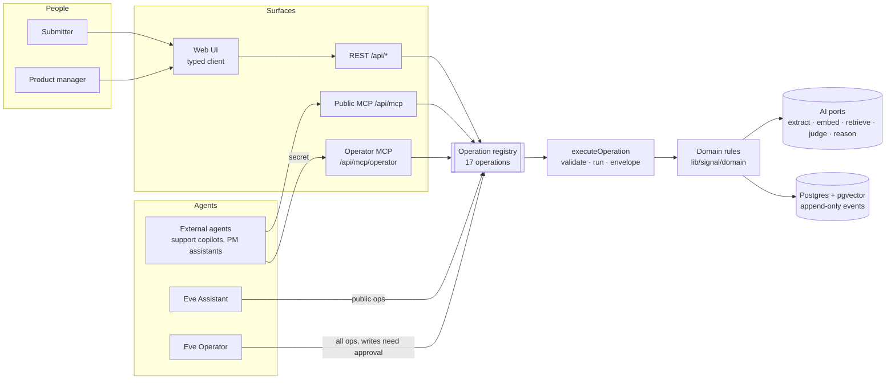

# Agent harness — visual docs

Snapshot of how Signal's agents, surfaces, AI pipelines, evals, and delivery loop fit together, as of **2026-10-30** (branch `spec/004-crewday-outcome-eval`). Diagrams are Mermaid; GitHub and most editors render them.

| Doc                                            | Perspective | What it shows                                                                 |
| ---------------------------------------------- | ----------- | ----------------------------------------------------------------------------- |
| [product-workflows.md](./product-workflows.md) | Product     | The six core journeys: submit, discover, track, triage, decide, agent         |
| [runtime.md](./runtime.md)                     | Tech        | Surfaces → adapters → one operation registry → domain → AI ports and database |
| [agents.md](./agents.md)                       | Tech        | Eve Assistant and Operator agents, MCP servers, chat routes, auth, models     |
| [ai-pipelines.md](./ai-pipelines.md)           | Tech        | Matching hot path, suggestion generation, triage resolution, decisions        |
| [evals.md](./evals.md)                         | Tech        | Test and eval layers: parity, domain, matching, agent behaviour, Crewday sim  |
| [dev-loop.md](./dev-loop.md)                   | Process     | Flow skills from idea to shipped commit, hooks, CI, deploy                    |

## The whole harness on one page

**The one rule:** every capability is one operation, defined once in `lib/signal/operations/`. REST, MCP, and Eve tools are generated from it, so no surface holds business logic, and the parity suite proves every surface returns the same output, errors, and events.

**What is not built yet:** the PM console UI (spec 001 task 08, spec 006), the live Crewday lift run (spec 004 task 04), and agent outcome evals (spec 005). Diagrams mark these as _planned_.
