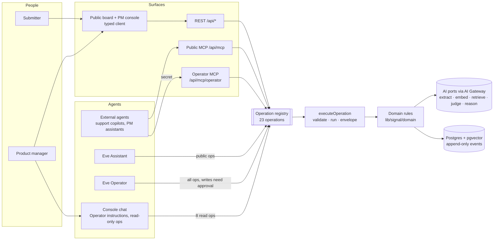

# Agent harness — visual docs

Snapshot of how Signal's agents, surfaces, AI pipelines, evals, and delivery loop fit together, as of **2026-10-30** (`main`, after specs 006, 007, and 010). Diagrams are Mermaid; GitHub and most editors render them.

| Doc                                            | Perspective | What it shows                                                                     |
| ---------------------------------------------- | ----------- | --------------------------------------------------------------------------------- |
| [product-workflows.md](./product-workflows.md) | Product     | The seven core journeys: submit, discover, track, triage, decide, agent, strategy |
| [runtime.md](./runtime.md)                     | Tech        | Surfaces → adapters → one operation registry → domain → AI ports and database     |
| [agents.md](./agents.md)                       | Tech        | Eve Assistant and Operator agents, console chat, MCP servers, auth, models, GenUI |
| [ai-pipelines.md](./ai-pipelines.md)           | Tech        | Matching hot path, suggestion generation, triage, readiness, decision briefs      |
| [evals.md](./evals.md)                         | Tech        | Test and eval layers: parity, domain, migrations, matching, agents, Crewday       |
| [dev-loop.md](./dev-loop.md)                   | Process     | Flow skills from idea to merged PR, hooks, permissions, CI, migrations, deploy    |

## The whole harness on one page

**The one rule:** every capability is one operation, defined once in `lib/signal/operations/`. REST, MCP, and Eve tools are generated from it, so no surface holds business logic, and the parity suite proves every surface returns the same output, errors, and events.

**What is not done yet:** a recorded live Crewday lift run (spec 004 task 04; the runner is built), its behaviour sweep and run history (tasks 05–07, deferred), agent outcome evals (spec 005), and the candidate specs 002, 003, 008, and 009. Diagrams mark these as _planned_.
