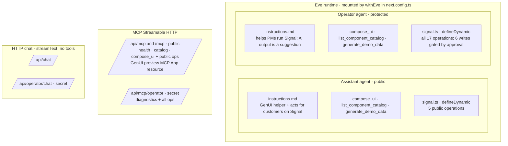
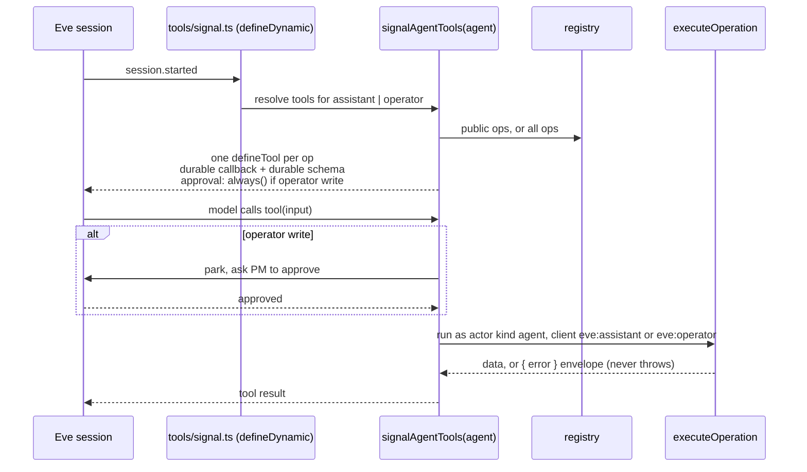
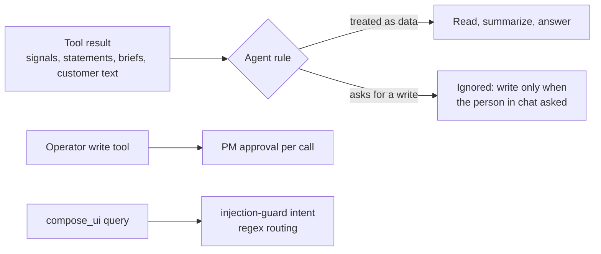
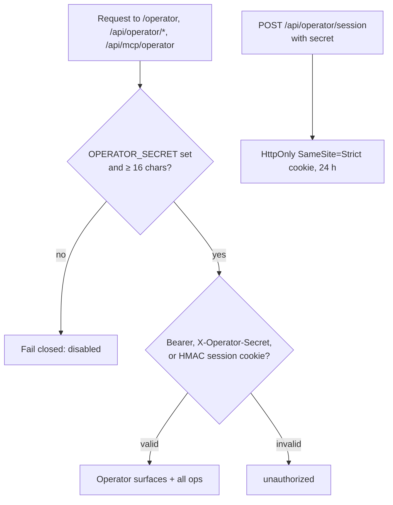
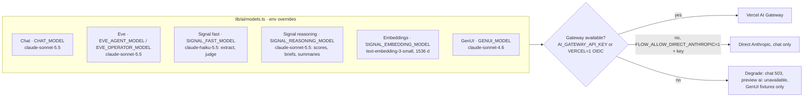
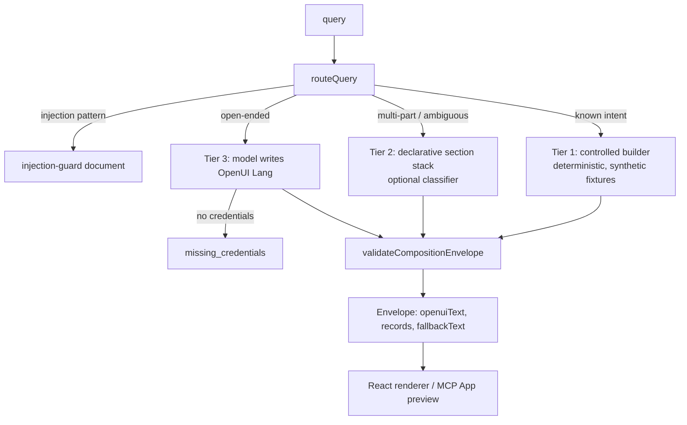

# Agents, MCP, and chat

Source: `agents/*/agent/`, `lib/signal/adapters/agent.ts`, `lib/mcp/`, `app/api/`, `lib/ai/models.ts`, [docs/INTEROP.md](../INTEROP.md).

## Inventory

Note: the two HTTP chat routes are plain `streamText` with a short system prompt and no tools; Signal actions go through Eve agents or MCP.

## How a Signal tool reaches an agent

Durable callbacks capture only the operation name, so a parked call replays in a fresh process.

## Prompt-injection guardrails

## Operator access

OAuth/OIDC for Operator is not implemented.

## Model routing

## GenUI compose (`compose_ui`, `/genui`)

