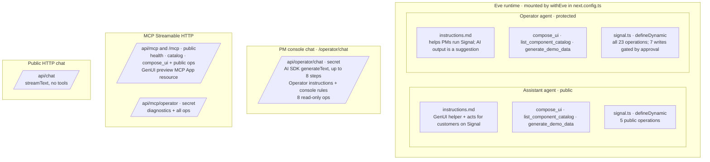
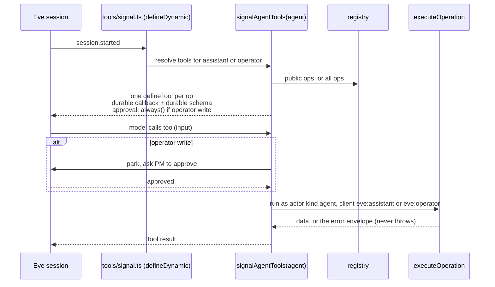
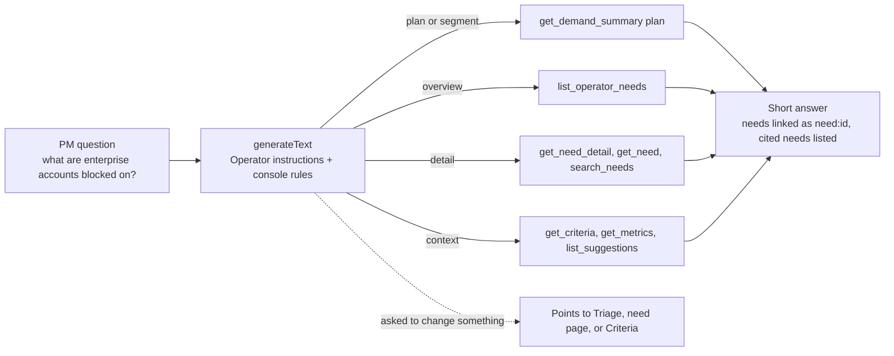
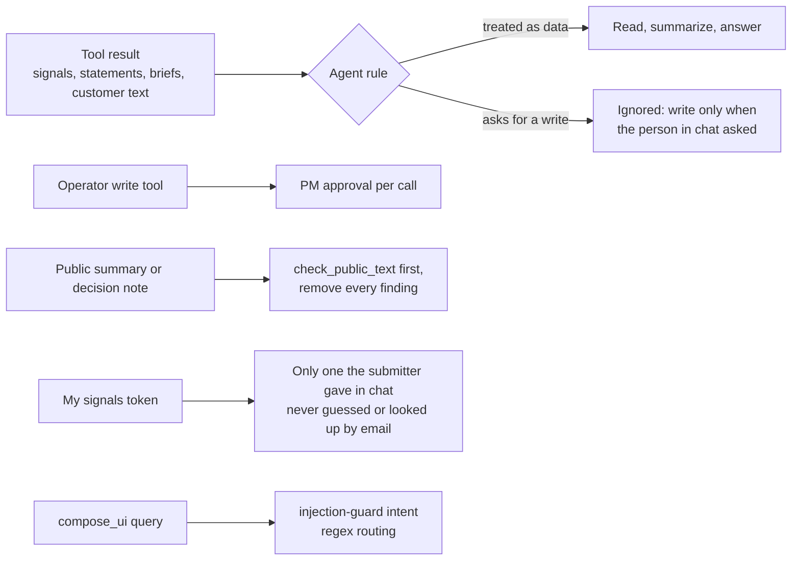
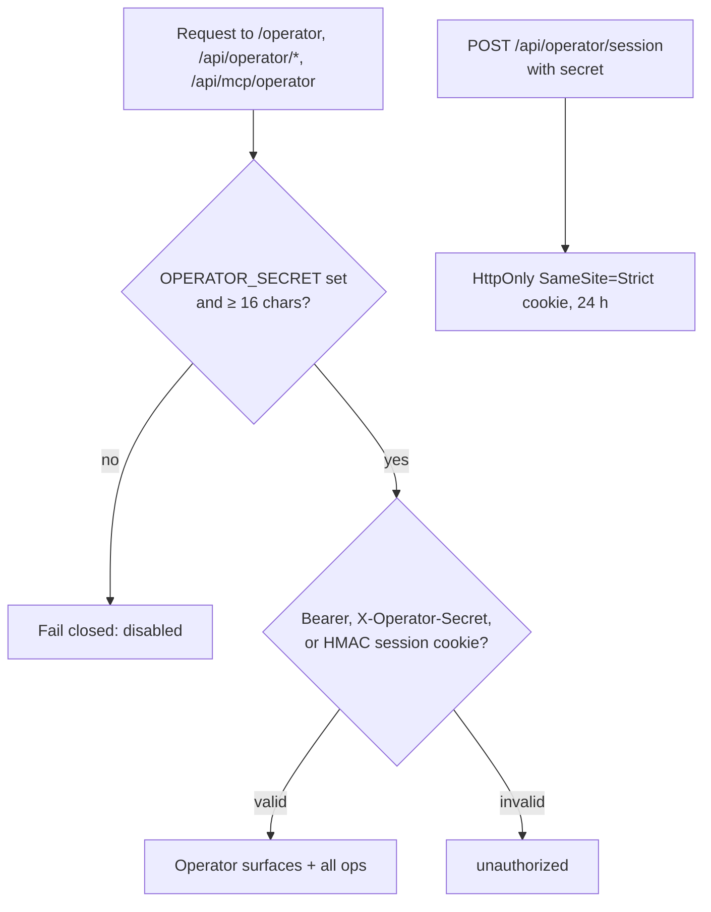
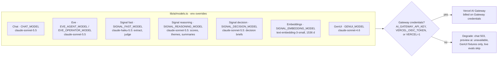
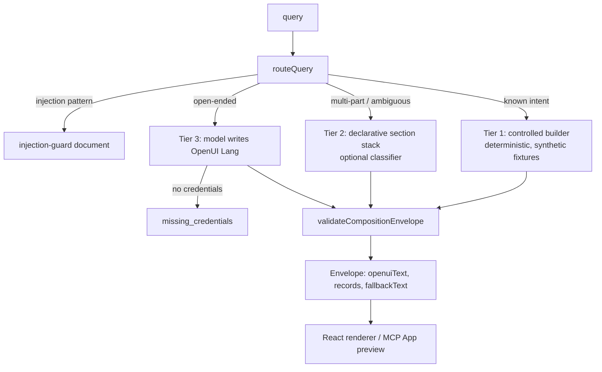

# Agents, MCP, and chat

Source: `agents/*/agent/`, `lib/signal/adapters/agent.ts`, `app/api/operator/chat/`, `lib/mcp/`, `lib/ai/models.ts`, [docs/INTEROP.md](../INTEROP.md), [spec 010](../specs/010-retro-remediation.md).

## Inventory

## How a Signal tool reaches an Eve agent

Durable callbacks capture only the operation name, so a parked call replays in a fresh process.

## Console chat answer

## Guardrails in agent instructions

## Operator access

OAuth/OIDC for Operator is not implemented.

## Model routing: AI Gateway only

There is no direct provider path, and lint rejects direct provider SDK imports. The local OIDC token from `vercel env pull` expires after about 12 hours.

## GenUI compose (`compose_ui`, `/genui`)

