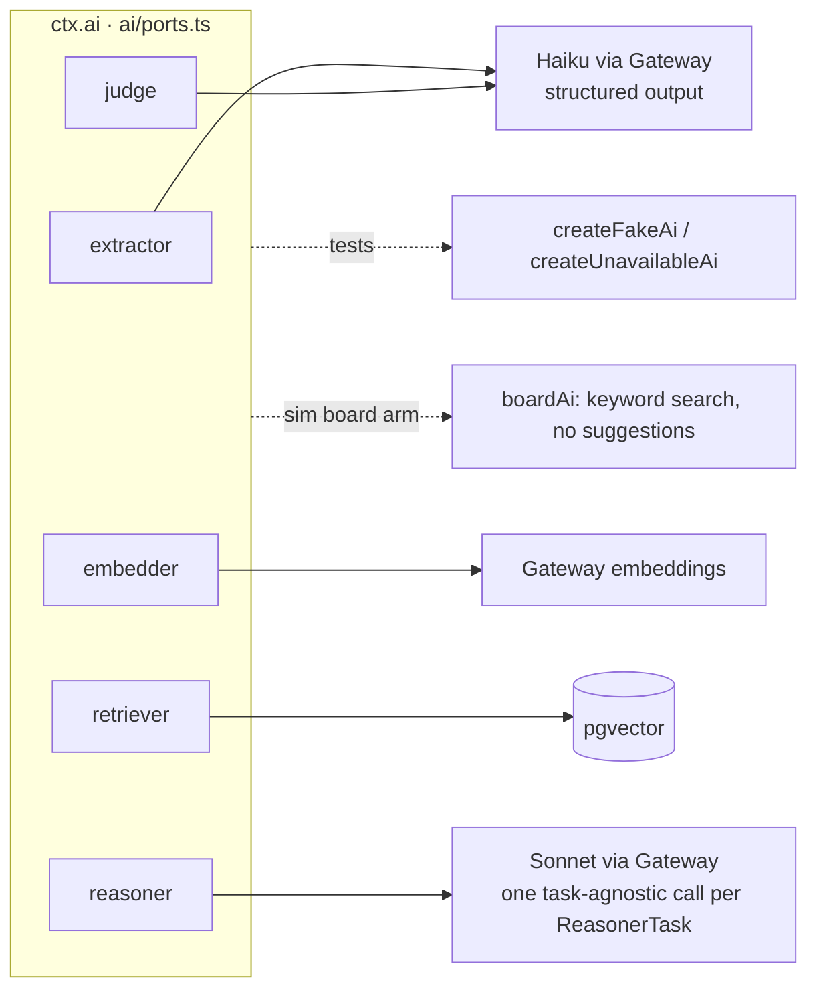
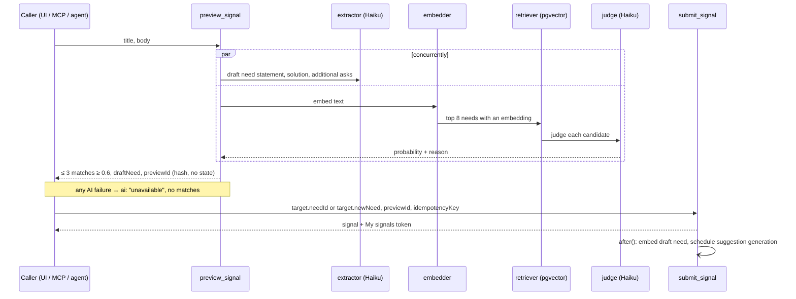
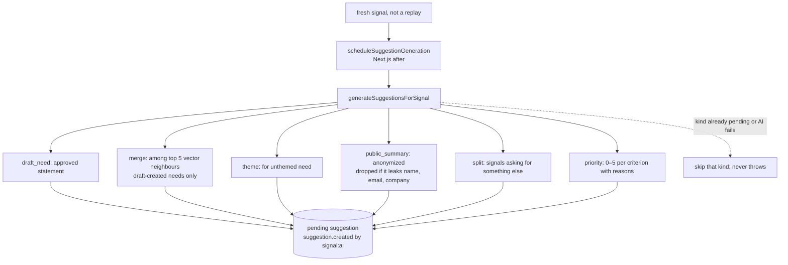
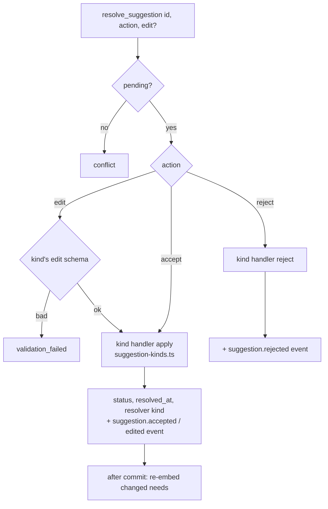
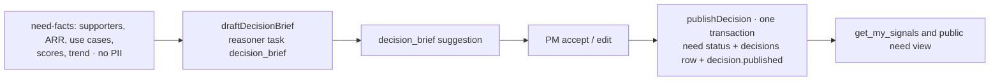

# AI pipelines

Fixed workflows, not agent loops, wherever the question is narrow ([decision 0002](../decisions/0002-retrieve-then-judge-matching.md)). Source: `lib/signal/domain/`, `lib/signal/ai/`.

## Ports

## Hot path: preview → submit

Budgets: ≤ 2 s p95, ≤ $0.01 per signal, false-match ≤ 5%.

## Off the hot path: suggestion generation

## Resolving a suggestion

| Kind           | Accept / edit applies                         |
| -------------- | --------------------------------------------- |
| draft_need     | draft → open, statement                       |
| merge          | `mergeNeeds`: move signals, `need.merged`     |
| theme          | set or create theme                           |
| public_summary | approve text; only now public                 |
| split          | `splitNeed`: new need, `need.split`           |
| priority       | upsert scores; PM edits stored with source pm |
| decision_brief | keep or replace markdown for publishing       |

## Decide

