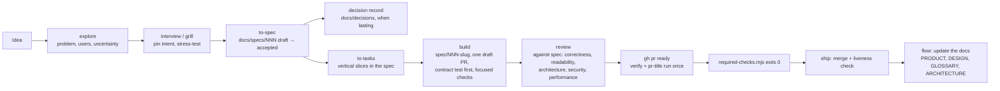
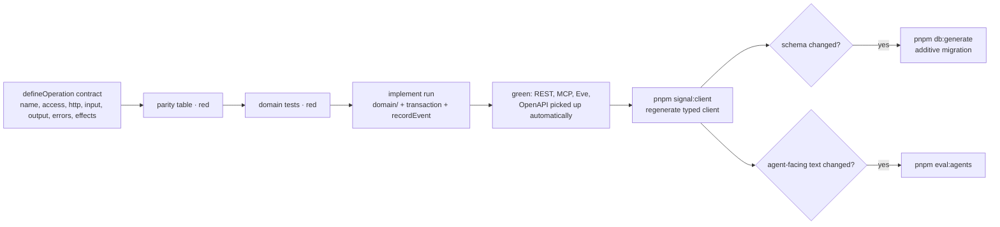
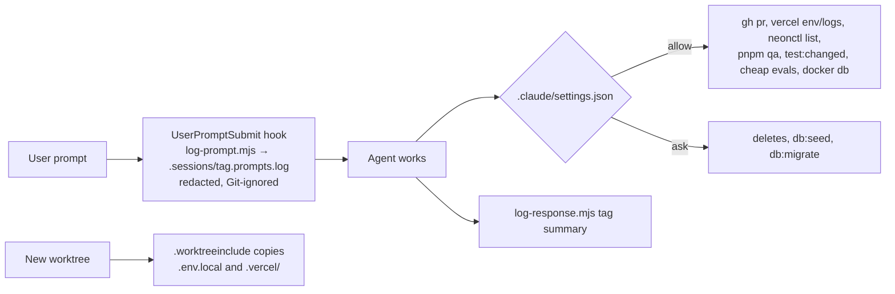
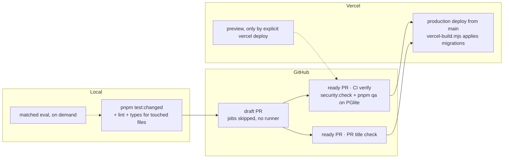
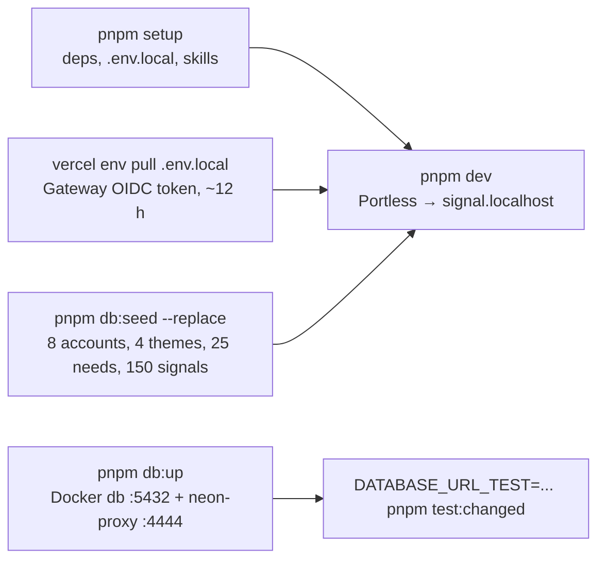

# Dev loop: Flow skills to merged PR

How work moves through this repo. Skills live in `.agents/skills/` (linked at `.claude/skills`), pinned by `skills-lock.json`. Source: [AGENTS.md](../../AGENTS.md) → Delivery, [docs/agent-skills.md](../agent-skills.md), [spec 010](../specs/010-retro-remediation.md), Flow [spec 048](https://github.com/gaboesquivel/flow-skills/blob/main/docs/specs/048-delivery-lifecycle.md).

## Idea to production

Side skills: `design` (visual direction → DESIGN.md), `prototype` (HTML rounds in `docs/design/`), `debug`, `domain-modeling` (GLOSSARY.md), `board` (spec progress from git), `align` / `measure`, `retro` (spec 010 came from one), `handoff`.

## Building one operation (test-first)

## Agent environment

## Gates

Each check runs once: workers run focused tests, ready-PR CI runs the full suite on the head, and `main` pushes run nothing. Commits run no Git hooks; the secret-file check runs in `security:check`. Don't re-run a green suite to confirm it.

## Local runtime

