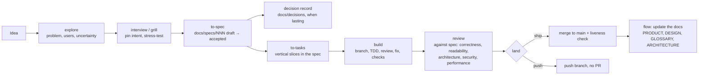
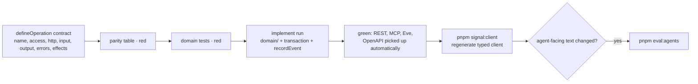
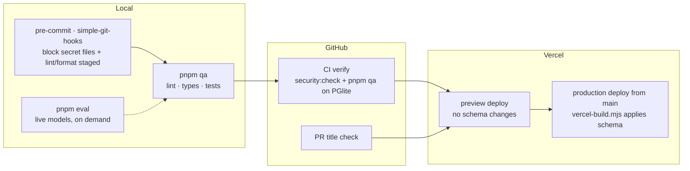
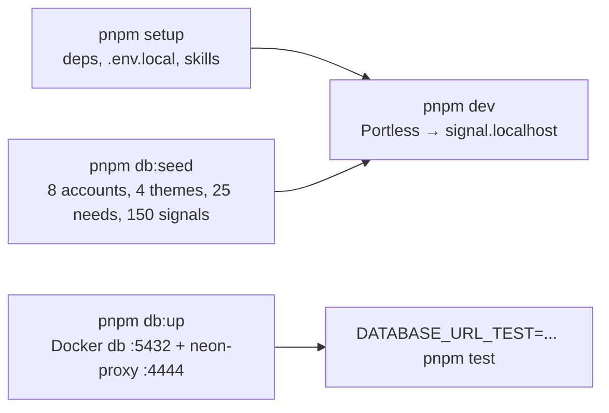

# Dev loop: Flow skills to shipped commit

How work moves through this repo. Skills live in `.agents/skills/` (linked at `.claude/skills`), pinned by `skills-lock.json`. Source: [AGENTS.md](../../AGENTS.md), [docs/agent-skills.md](../agent-skills.md).

## Idea to production

Side skills: `design` (visual direction → DESIGN.md), `prototype`, `debug`, `domain-modeling` (GLOSSARY.md), `board` (spec progress from git), `align` / `measure`, `retro`, `handoff`.

## Building one operation (test-first)

## Gates

## Local runtime

Every prompt to an agent in this repo is also logged to `prompts.txt` (AGENTS.md → Prompt Logging).
