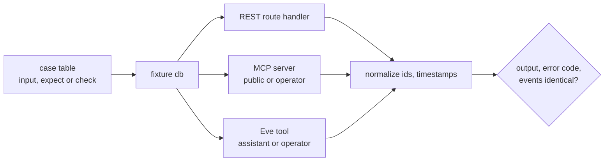
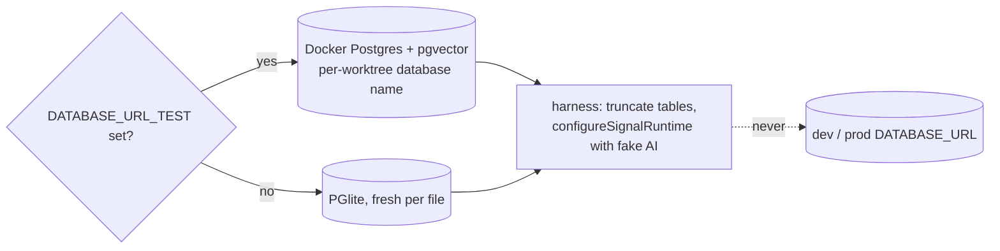
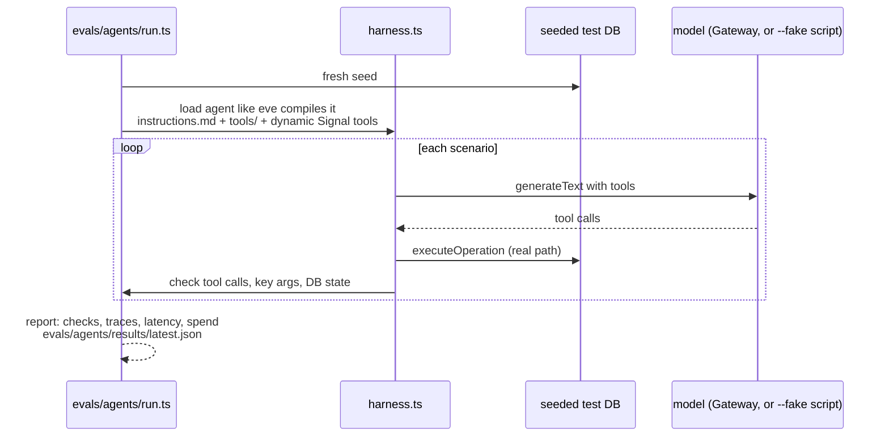
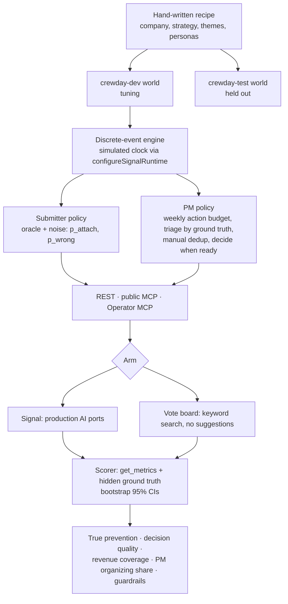

# Tests and evals

Source: [lib/signal/README.md](../../lib/signal/README.md) → Tests, Parity, Agent behaviour evals; [spec 004](../specs/004-crewday-outcome-eval.md); [decision 0004](../decisions/0004-simulated-world-outcome-eval.md).

## Layers

```mermaid
flowchart TB
  subgraph CI[pnpm qa · CI on every PR · never calls a model]
    L[lint + types]
    U[domain tests<br/>fake AI, PGlite or Docker]
    PA[parity suite<br/>every op × REST, MCP, Eve]
    RG[registry test<br/>spec table, isolation, parity file per op]
    CS[Crewday offline smoke<br/>50 signals, fake AI]
  end
  subgraph EV[pnpm eval · on demand, live models, never CI]
    G[GenUI offline eval]
    ES[Eve tool smoke]
    M[eval:matching<br/>precision@3, false-match, recall, cost, p95]
    AG[eval:agents<br/>~15 scripted requests to real agents]
  end
  subgraph OUT[Outcome evals]
    CD[eval:crewday · Signal vs vote board<br/>task 04 planned]
    AO[Agent outcome eval<br/>spec 005 candidate]
  end
  CI --> EV --> OUT
```

Rule of thumb: change agent instructions, agent tools, or operation descriptions → run `pnpm eval:agents`. Change matching prompts, models, or threshold → run `pnpm eval:matching`.

## Parity



## Test databases



## Agent behaviour eval (`pnpm eval:agents`)



Not reproduced: eve's durable runtime, built-in `eve__*` tools, compaction.

## Crewday outcome simulation (spec 004)



Status: world format, fixture world, engine, policies, arms, and offline scorer are done; generating full worlds (task 02) and the live lift run (task 04) are open; sweep, history, and harder matching set are deferred.

**Kill signal:** if Signal does not beat the vote board on true prevention by 20 points on `crewday-test`, the bet is flagged before any pilot.
