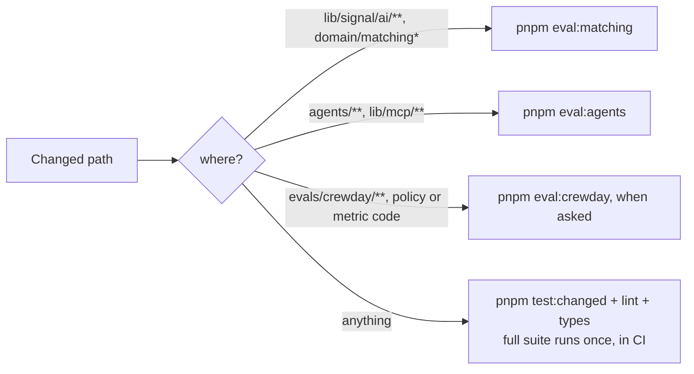
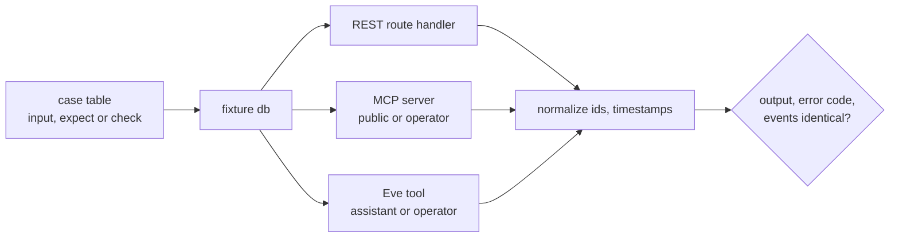
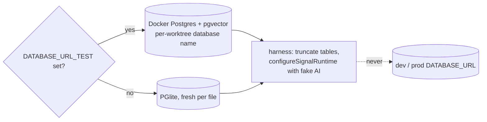
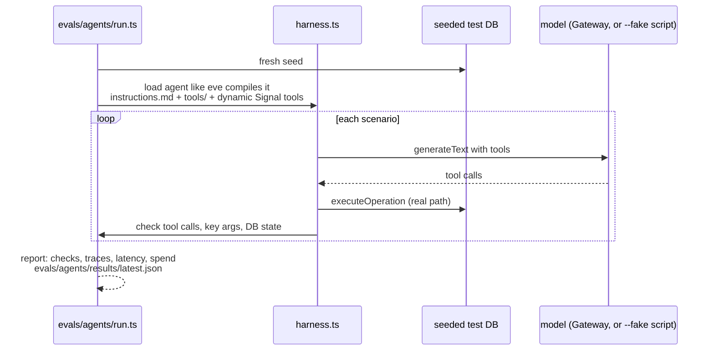
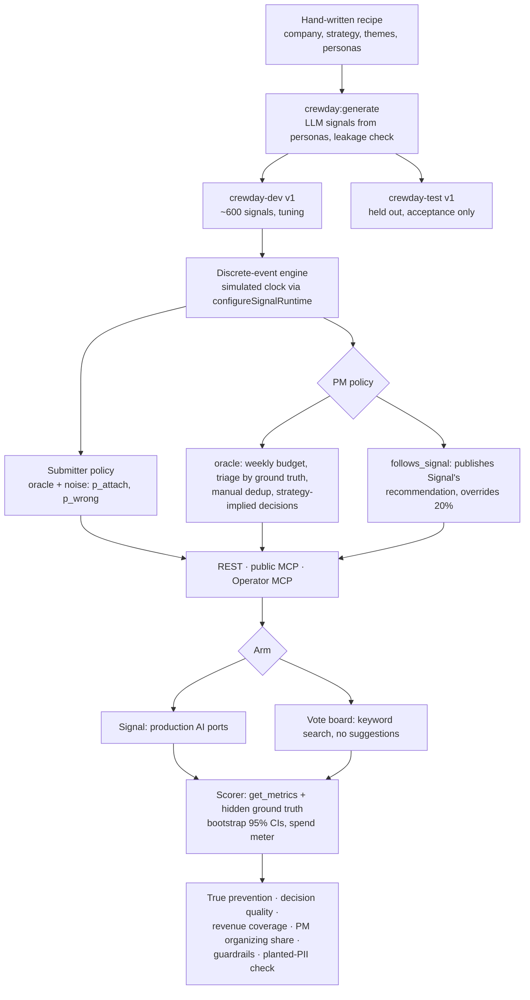

# Tests and evals

Source: [ARCHITECTURE.md](../../ARCHITECTURE.md) → Testing, [lib/signal/README.md](../../lib/signal/README.md), [spec 004](../specs/004-crewday-outcome-eval.md), [spec 010](../specs/010-retro-remediation.md), [decision 0004](../decisions/0004-simulated-world-outcome-eval.md).

## Layers

```mermaid
flowchart TB
  subgraph CI[pnpm qa · CI on every PR · never calls a model]
    L[lint + types<br/>lint rejects direct provider SDKs]
    U[domain tests<br/>fake AI, PGlite or Docker]
    PA[parity suite<br/>every op × REST, MCP, Eve]
    RG[registry test<br/>spec table, isolation, parity file per op]
    MS[migration and deploy safety]
    CS[Crewday offline tests<br/>fixture world, fake AI]
    GD[ci-contract: live evals refuse to run in CI]
  end
  subgraph EV[pnpm eval · cheap tier, live models, on demand]
    G[GenUI offline eval]
    ES[Eve tool smoke]
    M[eval:matching<br/>precision@3, false-match, recall, cost, p95]
    AG[eval:agents<br/>~15 scripted requests to real agents]
  end
  subgraph OUT[Outcome evals · dollars, only when asked]
    CD[eval:crewday<br/>Signal vs vote board]
    AO[Agent outcome eval<br/>spec 005, later]
  end
  CI --> EV --> OUT
```

No UI tests: pages are checked by hand in a browser against DESIGN.md.

## Which eval a change needs



## Parity



## Test databases



## Agent behaviour eval (`pnpm eval:agents`)



Not reproduced: eve's durable runtime, built-in `eve__*` tools, compaction.

## Crewday outcome simulation (`pnpm eval:crewday`)



Status: worlds generated and runner merged; the first recorded live lift run on `crewday-dev` (task 04) is still open, and the sweep, tagged history, and harder matching set are deferred. Runs refuse any database that is not local Docker or PGlite.

**Kill signal:** if Signal does not beat the vote board on true prevention by 20 points on `crewday-test`, the bet is flagged before any pilot.
