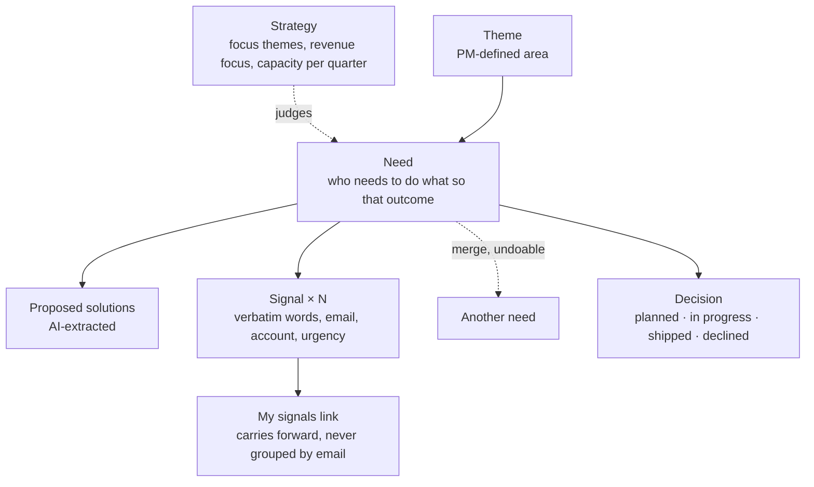
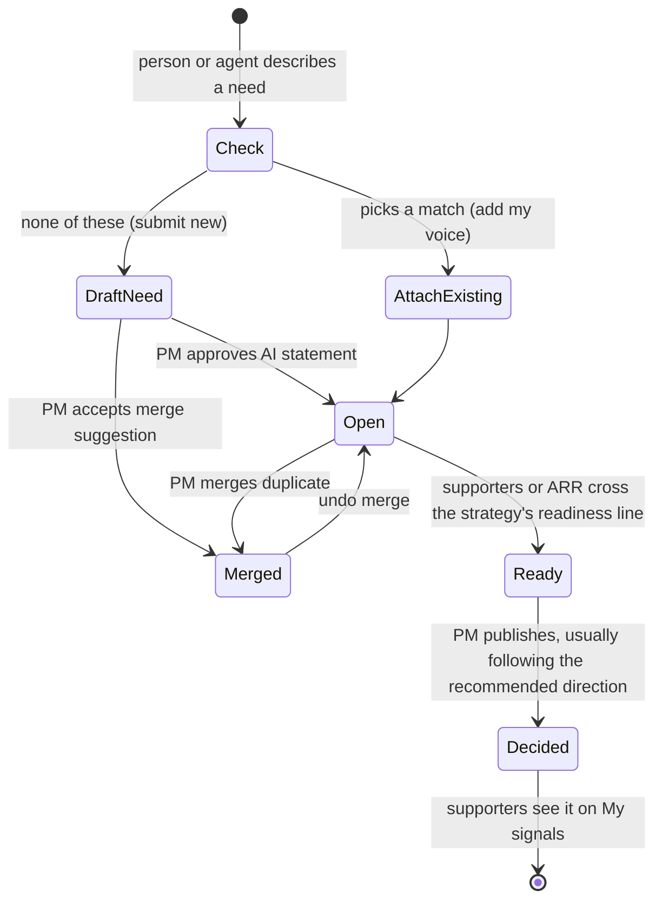
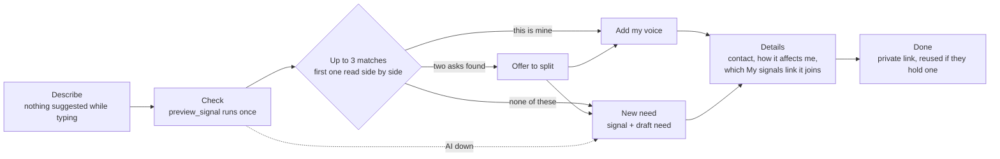
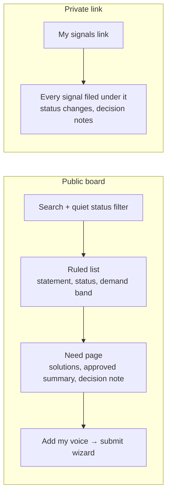
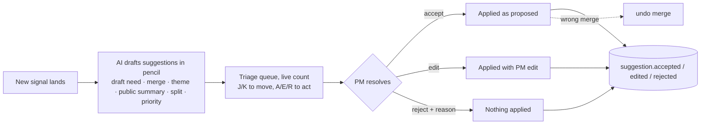
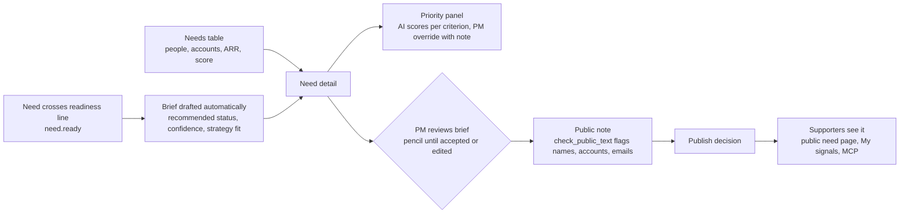
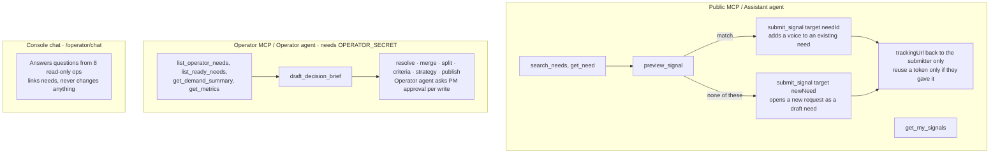
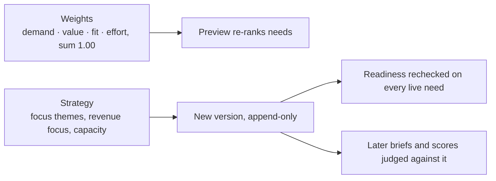
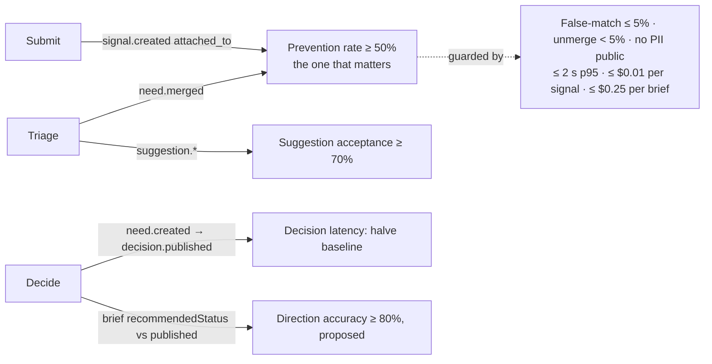

# Product workflows

Signal turns feature requests into decisions. AI proposes in pencil; people confirm in ink. Source: [PRODUCT.md](../../PRODUCT.md), [DESIGN.md](../../DESIGN.md), specs [001](../specs/001-signal-mvp.md), [006](../specs/006-lean-ledger-ui.md), [007](../specs/007-decision-direction.md).

## The model

## Lifecycle of a request

## 1. Submit with a duplicate check (submitter)

The prioritized problem: duplicates and lost context at the moment of submission. Web submit is a four-step wizard at `/submit`.

## 2. Discover and support · 3. Track my signals

Public views never show who asked, emails, companies, revenue, verbatim signals, or unapproved summaries.

## 4. PM triage (`/operator/triage`)

## 5. PM decide and communicate (`/operator/needs`, `/operator/decide`)

## 6. Agents as first-class users

## 7. PM strategy and criteria (`/operator/criteria`)

## Metrics each journey feeds

Last live measurements (2026-10-30): p95 4.7 s and $0.014 per signal, both over their guardrails.
