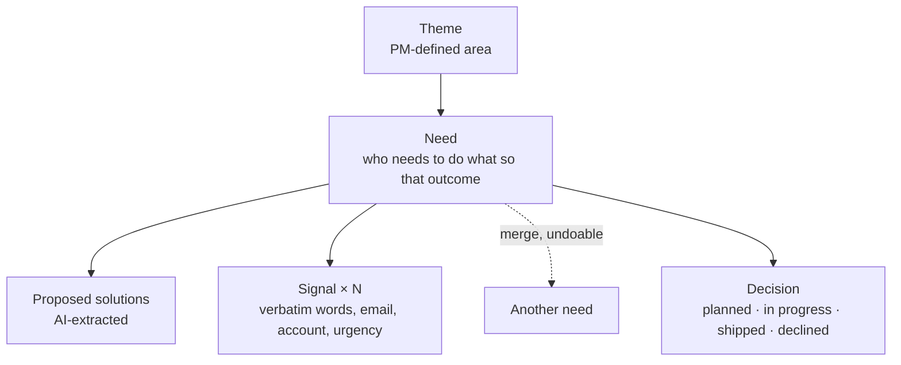
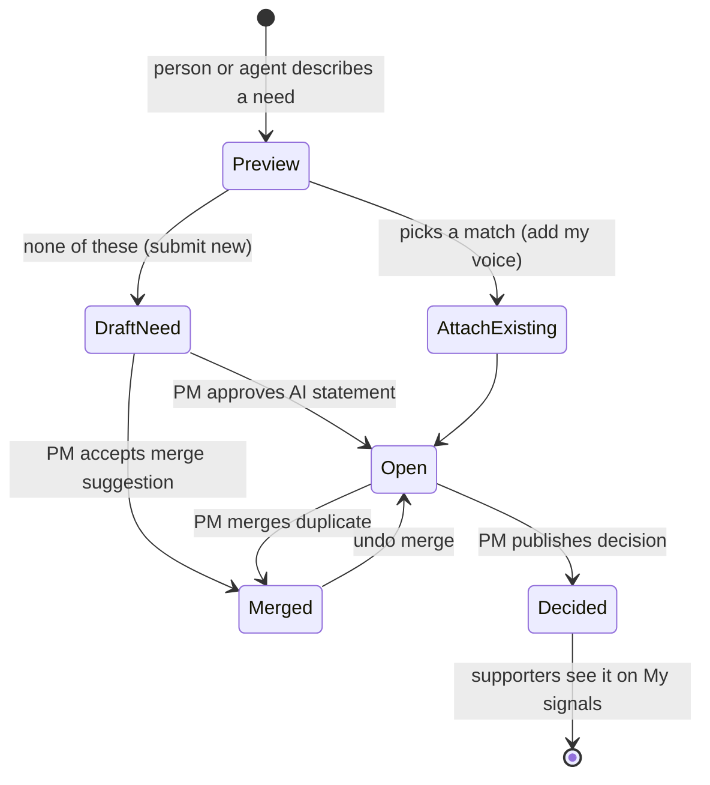
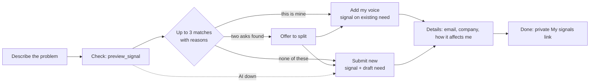
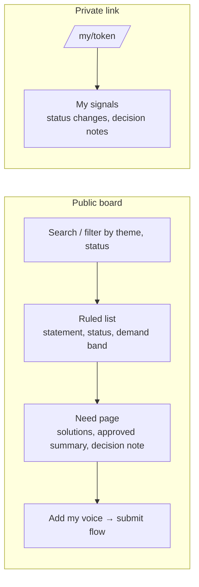
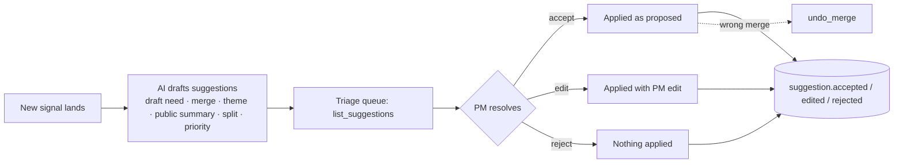
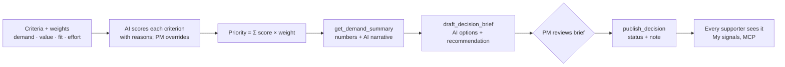
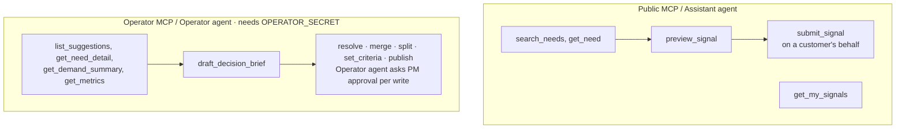
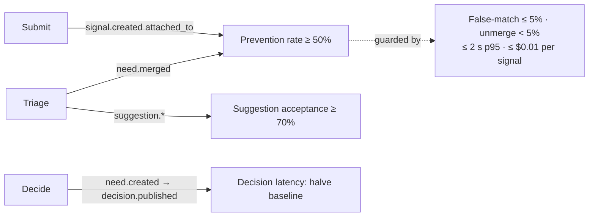

# Product workflows

Signal turns feature requests into decisions. AI proposes; people decide. Source: [PRODUCT.md](../../PRODUCT.md), [spec 001](../specs/001-signal-mvp.md), [spec 006](../specs/006-lean-ledger-ui.md).

## The model

## Lifecycle of a request

## 1. Submit with a duplicate check (submitter)

The prioritized problem: duplicates and lost context at the moment of submission.

Spec 006 changes the UI to a wizard (Describe → Check → Details → Done) with no suggestions while typing, and makes the My signals link carry forward across submissions (decision 0005).

## 2. Discover and support · 3. Track my signals

Public views never show who asked, emails, companies, revenue, verbatim signals, or unapproved summaries.

## 4. PM triage

## 5. PM decide and communicate

## 6. Agents as first-class users

## Metrics each journey feeds

