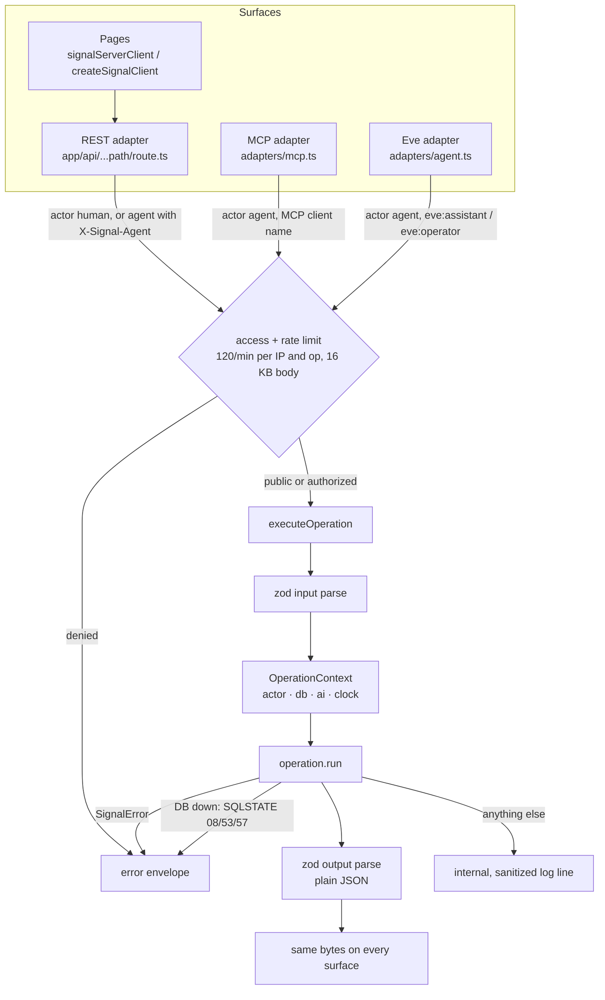
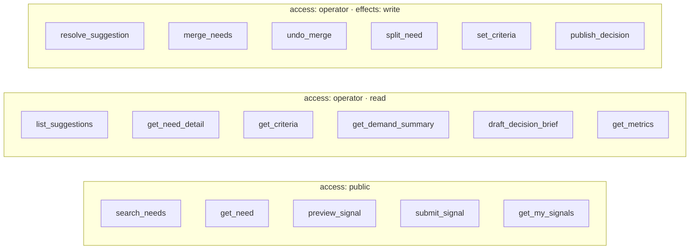
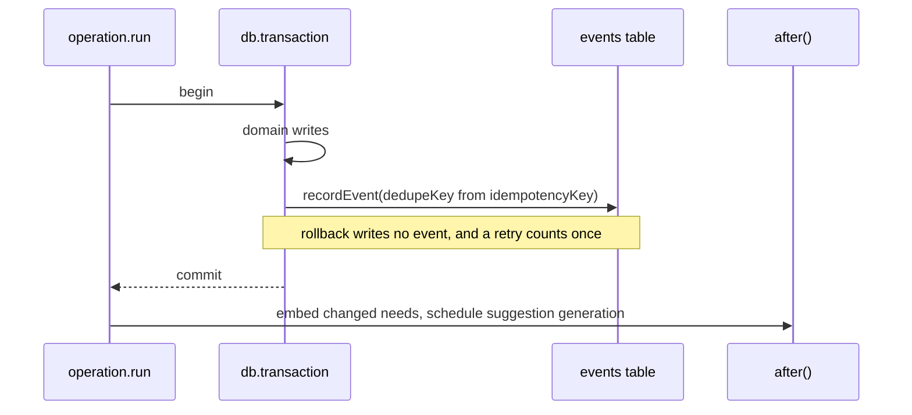
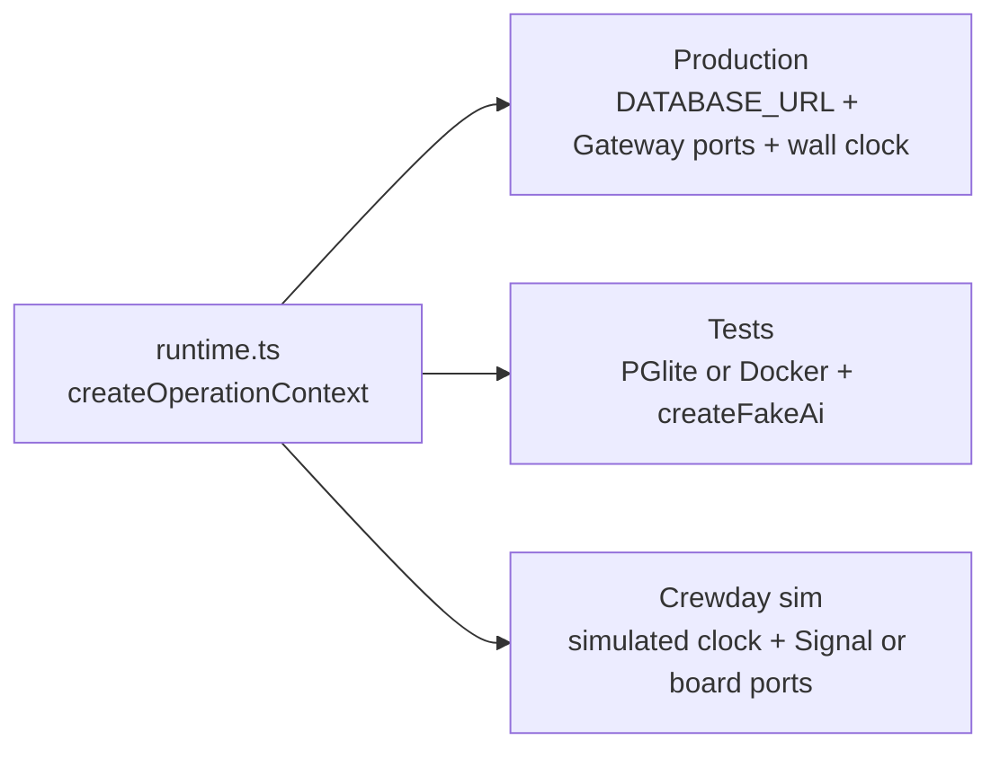
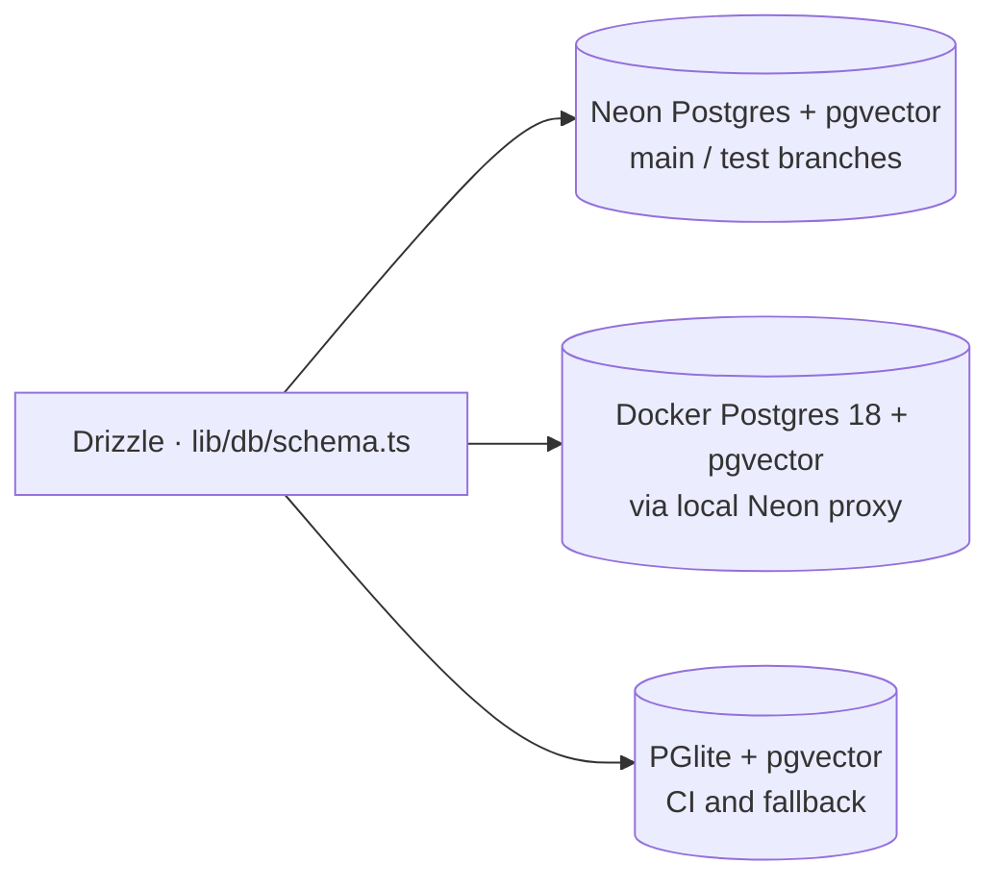

# Runtime: one registry, many surfaces

Source: [lib/signal/README.md](../../lib/signal/README.md), [ARCHITECTURE.md](../../ARCHITECTURE.md).

## Request path

Error envelope: `{ error: { code, message, retryable } }`.

## Operations (17)

| Surface                             | Public ops | Operator ops  | Notes                                                          |
| ----------------------------------- | ---------- | ------------- | -------------------------------------------------------------- |
| REST                                | yes        | bearer secret | `/api/...`, `/api/operator/...`; also OpenAPI                  |
| Public MCP                          | yes        | absent        | plus `health`, `list_component_catalog`, `compose_ui`          |
| Operator MCP                        | yes        | yes           | plus `operator_health`, `config_status`, `public_tool_catalog` |
| Eve Assistant                       | yes        | absent        | plus GenUI tools                                               |
| Eve Operator                        | yes        | yes           | write ops require PM approval (`always()`)                     |
| OpenAPI, `.well-known`, server card | yes        | never         | discovery lists public only                                    |

## Write path and events

## Context seam

`configureSignalRuntime({ db, ai, clock })` is the one seam tests, parity, and the simulator use. Operations must never read wall-clock time directly.

## Data

Production builds on Vercel apply the schema (`scripts/vercel-build.mjs`); previews never change the shared database.
